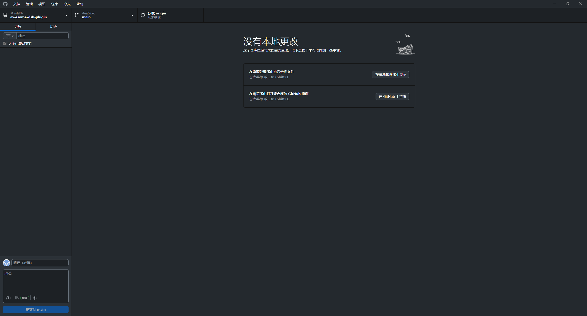

# github-desktop-zh

> Unofficial Chinese localization patch for GitHub Desktop · one-click install, fully revertible

[](LICENSE)
[](https://desktop.github.com/)
[](#install-windows)

An **unofficial** Chinese (Simplified) language patch for [GitHub Desktop](https://desktop.github.com/).

GitHub Desktop ships with no internationalization at all — there is not a single
`i18n` reference inside its 3 MB `renderer.js`. This project injects a small
runtime translation layer, so the UI speaks Chinese **without modifying the app's
original code**, and can be removed just as easily.



## Highlights

- **One-line install, one-line revert** — the only added file is `zh-cn.js`
- **Upgrade-friendly**: re-run the script after a GitHub Desktop update (takes 5 s)
- **Broad coverage**: menus, toolbar, changes/history, commit form, all 9 tabs of
  the Options dialog, About dialog, clone/create repository dialogs, git progress
  lines, relative timestamps
- Ships **only translations and scripts** — no GitHub Desktop code or binaries

## Install (Windows)

```powershell
powershell -NoProfile -ExecutionPolicy Bypass -File .\install.ps1
```

Revert:

```powershell
powershell -NoProfile -ExecutionPolicy Bypass -File .\install.ps1 -Revert
```

## Install (macOS)

```bash
bash install-macos.sh          # install
bash install-macos.sh --revert # revert
```

Modifying a `.app` bundle invalidates its code signature; the script performs an
ad-hoc re-sign automatically. If macOS still reports the app as damaged:

```bash
sudo codesign --force --deep --sign - "/Applications/GitHub Desktop.app"
xattr -dr com.apple.quarantine "/Applications/GitHub Desktop.app"
```

## How it works

`zh-cn.js` is a `MutationObserver`-driven translation layer: it watches the DOM and
swaps text nodes plus `placeholder` / `title` / `aria-label` / `alt` attributes
using a ~500-entry dictionary and a set of regex rules for dynamic strings
("Commit to main", "Fetching origin", "3 days ago", …).

The webpack bundle is intentionally left untouched: patching it would be destroyed
by every update and risks breaking the app. The layer is purely additive.

## Not covered yet

Publish flow details, PR creation dialogs, stash/conflict UIs, error and crash
pages. Issues with a screenshot are very welcome.

## Disclaimer

This project is not affiliated with, authorized, or endorsed by GitHub, Inc.
"GitHub" and "GitHub Desktop" are trademarks of GitHub, Inc.
This repository contains only translation mappings and installation scripts.

## License

[MIT](LICENSE)
