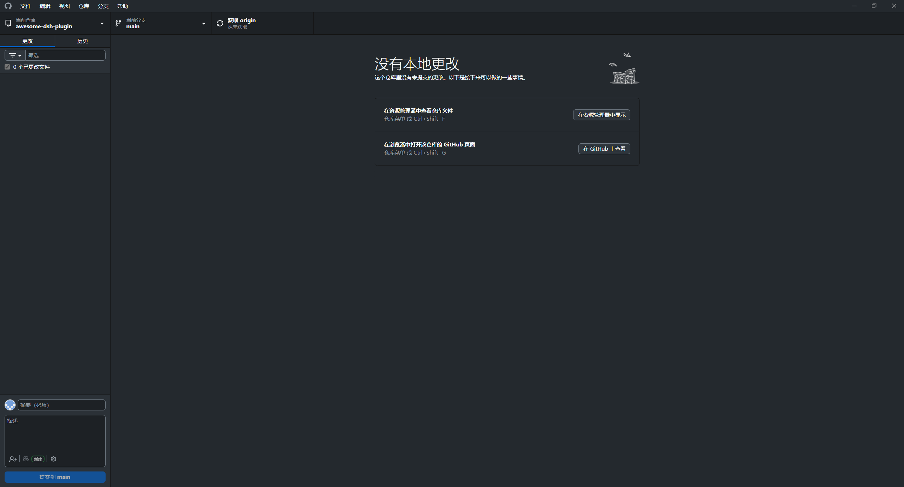

# GitHub Desktop 中文补丁（github-desktop-zh）

给 [GitHub Desktop](https://desktop.github.com/) 做界面汉化的非官方补丁。

官方至今没有多语言支持（3MB 的 `renderer.js` 里连 `i18n` 这个词都没有），
这个项目用一个**运行时翻译层**把界面换成中文——不改原程序，随时可还原。



## 特点

- **一键安装 / 一键还原**，不碰 GitHub Desktop 的任何原始文件（只加一个 `zh-cn.js`）
- **升级不糟心**：GitHub Desktop 升级会覆盖安装目录，重跑一次脚本即可（5 秒）
- **覆盖广**：菜单栏、工具栏、更改/历史、提交表单、选项对话框 9 个标签页、
  关于对话框、克隆/新建仓库对话框、git 进度、相对时间
- **只发翻译层**，不分发 GitHub Desktop 的任何代码或二进制

## 安装（Windows）

```powershell
# 1. 下载这个仓库（Code → Download ZIP，或者 git clone）
# 2. 在解压后的目录里执行：
powershell -NoProfile -ExecutionPolicy Bypass -File .\install.ps1
```

脚本会自动找到你装的 GitHub Desktop 版本目录、备份 `index.html`、装好翻译层、
重启应用。看到界面变中文就成了。

**还原成英文：**

```powershell
powershell -NoProfile -ExecutionPolicy Bypass -File .\install.ps1 -Revert
```

**其他参数：**

| 参数 | 作用 |
| --- | --- |
| `-Revert` | 还原成英文原版（删掉翻译层，恢复备份） |
| `-NoRestart` | 只打补丁，不自动重启 |
| `-Debug` | 额外开启本机调试端口 9333（给改翻译的人用，普通用户别开） |

## 安装（macOS）

```bash
git clone https://github.com/EMLxxf/github-desktop-zh.git
cd github-desktop-zh
bash install-macos.sh
```

macOS 上修改 `.app` 内部会让代码签名失效，脚本会自动做一次 ad-hoc 重新签名
（`codesign --force --deep --sign -`）。如果系统仍提示「已损坏」，
执行 `xattr -dr com.apple.quarantine "/Applications/GitHub Desktop.app"`。

还原：`bash install-macos.sh --revert`

## 升级后怎么办

GitHub Desktop 用 Squirrel 更新，升级时会**整个替换** `app-x.y.z` 目录，
补丁随之消失（界面变回英文）。**重跑一次安装脚本就好**，不到 5 秒。

小提示：如果你不想每次升级都重打，可以在设置里关掉自动更新。
不过新版本可能修了 bug，不建议长期这么干。

## 覆盖范围

| 界面 | 状态 |
| --- | --- |
| 菜单栏（文件/编辑/视图/仓库/分支/帮助，含快捷键列） | ✅ |
| 工具栏、当前仓库/分支、更改、历史 | ✅ |
| 提交表单、空状态提示 | ✅ |
| 选项对话框 9 个标签页（账户/集成/Copilot/Git/外观/通知/提示/高级/辅助功能） | ✅ |
| 关于对话框、克隆仓库、新建仓库 | ✅ |
| git 进度（接收对象/解析差异…）、相对时间（上周/上个月/3 天前） | ✅ |
| 发布(Publish)流程细节、创建 PR、贮藏/冲突解决、错误页 | ⚠️ 部分/未覆盖 |

遇到没翻译到的英文？欢迎提 issue，附上界面截图和所在位置即可。

## 原理

```
resources/app/
  index.html   ← 加了一行 <script defer src=zh-cn.js>
  zh-cn.js     ← 本项目的翻译层
  main.js      ← 只在 -Debug 时加一行调试开关
```

`zh-cn.js` 用 `MutationObserver` 监听 DOM，把文本节点、`placeholder`、`title`、
`aria-label`、`alt` 逐条换成中文。字典约 500 条，配一批正则规则处理
「提交到 main」「正在获取 origin」「3 天前」这类动态串。

没改 `renderer.js` 是有意的：那是 webpack 打包的 3MB 单文件，改它升级即报废，
而且很容易把应用改崩。翻译层是纯增量，出问题删掉文件就复原了。

## 已知限制

- 只测过 **3.6.10 (x64, Windows)** 与 3.6.x 系 macOS 版；其他版本路径一样，接口基本稳定，但可能漏词
- 翻译是人工维护的，个别长句可能不地道，欢迎 PR
- 极少数长句是 React 拆成多个文本节点渲染的，靠 `translateSimpleBlocks` 整块替换，
  遇到动态内容拼在中间的句子可能翻不全

## 非官方声明

本项目与 GitHub, Inc. 无任何关联，未获其授权或背书。
「GitHub」「GitHub Desktop」是 GitHub, Inc. 的商标。
本项目只包含界面文字的翻译映射与安装脚本，不包含 GitHub Desktop 的任何代码。

## 许可

[MIT](LICENSE)
